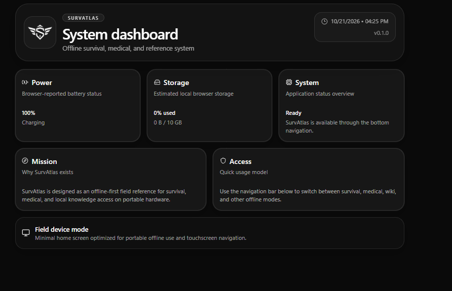
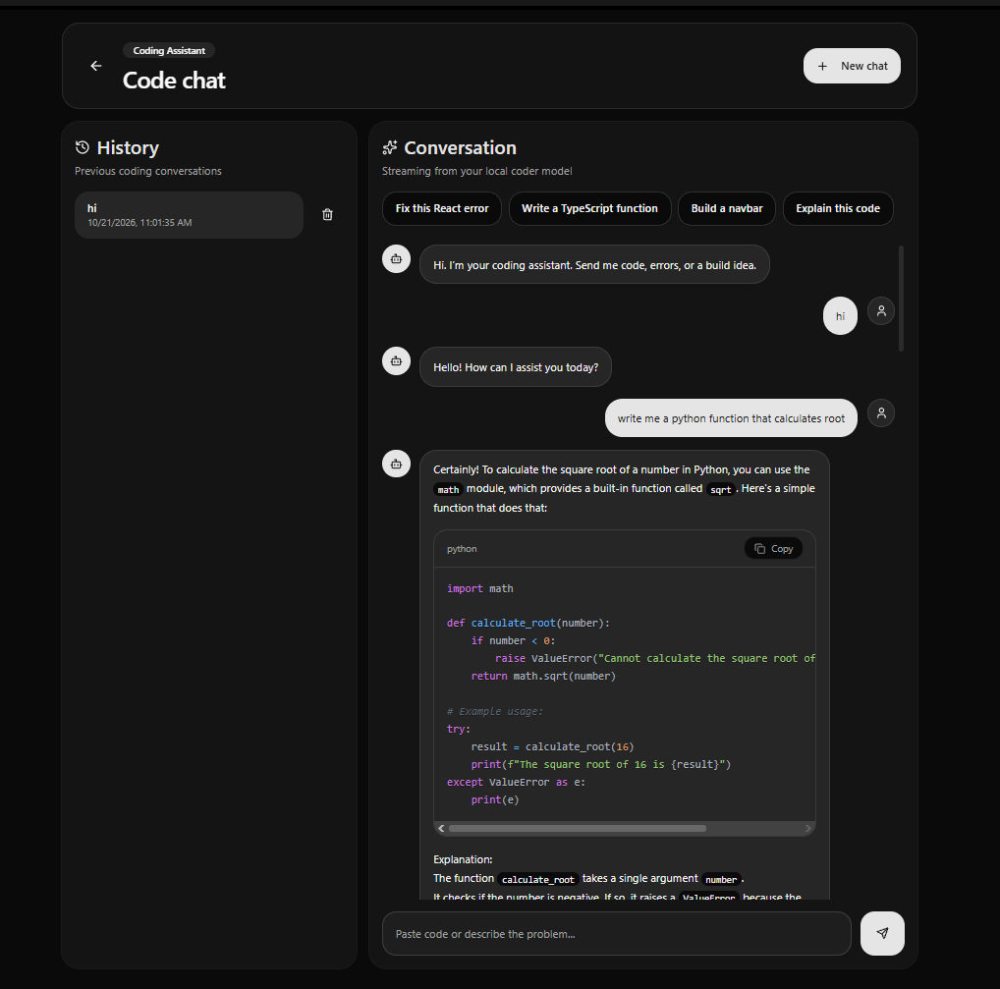
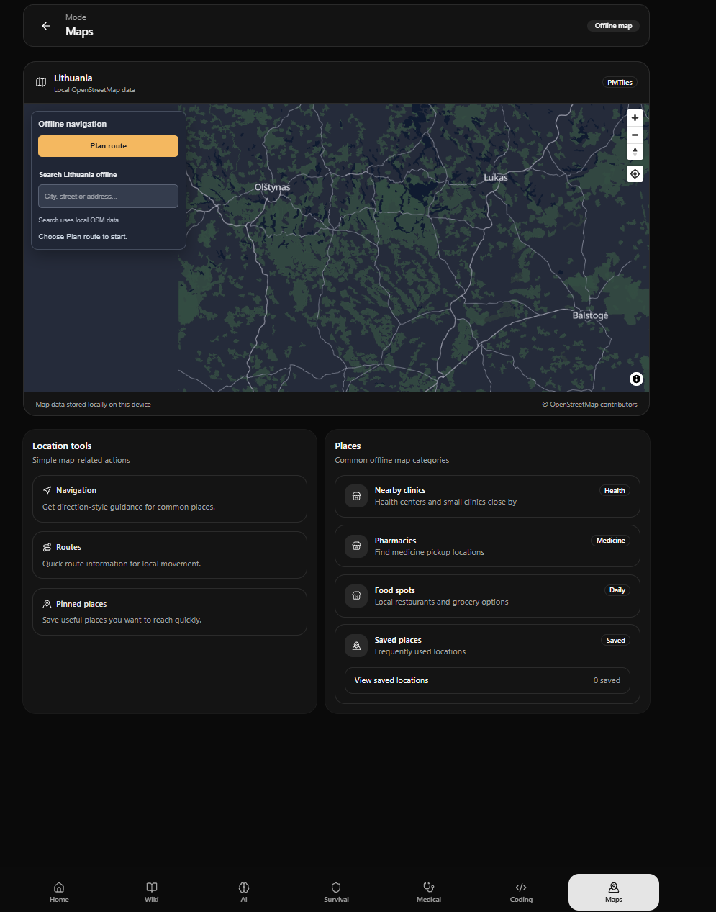

# SurvAtlas

### An offline-first emergency information tablet — in development

**Local AI · Offline maps · Practical reference information · Portable hardware vision**

SurvAtlas is an independent project exploring how essential information and useful tools can remain accessible when internet connectivity is unavailable.

[**Development roadmap**](ROADMAP.md) · [**Project progress**](#development-progress) · [**Report an issue**](https://github.com/KA-MIS/survatlas/issues/new/choose)

---

> [!NOTE]
> **Project stage: Active development and prototyping.** This repository is the public project showcase. The application and operating-system implementation are maintained separately and are not distributed here.

## The idea

SurvAtlas aims to bring maps, practical survival and medical reference information, and a locally running AI assistant together in a dedicated tablet experience. The goal is to make useful resources available without depending on a cloud account or an active internet connection.

The long-term vision is a portable, battery-powered device that is straightforward to use when connectivity is limited or unavailable.

## Current development preview

The images below show parts of the current software in development. They are **not final product renders** and do not imply that the finished physical tablet is available.

<table>
  <tr>
    <td width="50%" align="center">
      
       <strong>Application dashboard</strong> A central place to access the main tools and system information
    </td>
    <td width="50%" align="center">
      
       <strong>Local AI assistant</strong> An assistant designed to run locally on the device
    </td>
  </tr>
</table>

  
   <strong>Maps and navigation</strong> 
  An existing part of the application experience

## What we're building

| Area | Direction |
| --- | --- |
| **Offline information** | Access to locally available maps and reference material |
| **Local AI** | An assistant designed to operate on-device without a cloud AI service |
| **Simple tablet experience** | A clear, touch-friendly interface for essential tools |
| **Dedicated startup experience** | A branded boot-to-dashboard flow for the SurvAtlas environment |
| **Portable hardware** | A future self-contained tablet with careful attention to power and reliability |

## Development progress

### October 2026 — Startup and application quality milestone

Recent work has moved the project forward in two areas:

- **Branded startup:** a custom SurvAtlas loading experience and automatic kiosk launch have been integrated in the development prototype.
- **Local application startup:** the dashboard can signal when it is ready, helping coordinate the transition from loading screen to application.
- **On-device AI direction:** the OS prototype uses a locally hosted AI runtime rather than requiring an external AI server.
- **Code quality:** a set of reported lint errors was resolved, TypeScript validation passed, and a production build completed successfully in the development environment.
- **Interface refinements:** work included assistant error handling, navigation, saved-place behavior, search behavior, and device-status typing.

These are software development milestones—not a claim that the finished tablet is ready for sale or certified for emergency use.

### What comes next

- Verify core workflows through repeatable offline tests
- Continue improving startup and recovery behavior
- Test on physical target hardware
- Evaluate power use, thermal behavior, performance, and usability
- Share further screenshots and demonstrations as features are verified

Follow the [development roadmap](ROADMAP.md) for the broad project stages.

## Transparency and limitations

SurvAtlas is experimental and under active development. The intended architecture emphasizes local operation, but end-to-end offline verification across the eventual physical device remains ongoing. A successful software build does not establish hardware readiness, battery life, or emergency reliability.

SurvAtlas is **not a certified medical device, emergency communications system, or replacement for emergency services or qualified professional guidance**. Medical references and AI-generated information require independent evaluation.

## About this repository

This is the public project overview for people interested in SurvAtlas, its goals, and its progress. It intentionally focuses on product direction and high-level milestones rather than publishing the private implementation.

For questions, suggestions, or public project feedback, use the [issue tracker](https://github.com/KA-MIS/survatlas/issues).

---

**SurvAtlas — Offline. Independent. Prepared.**

